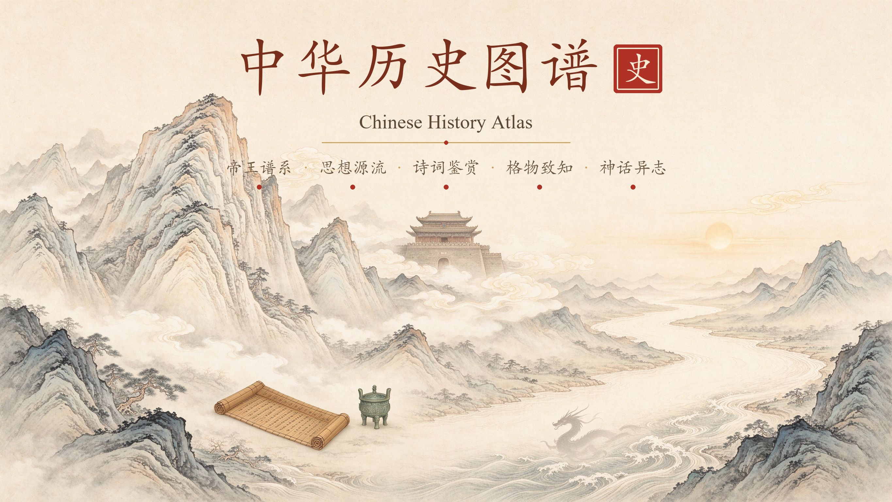
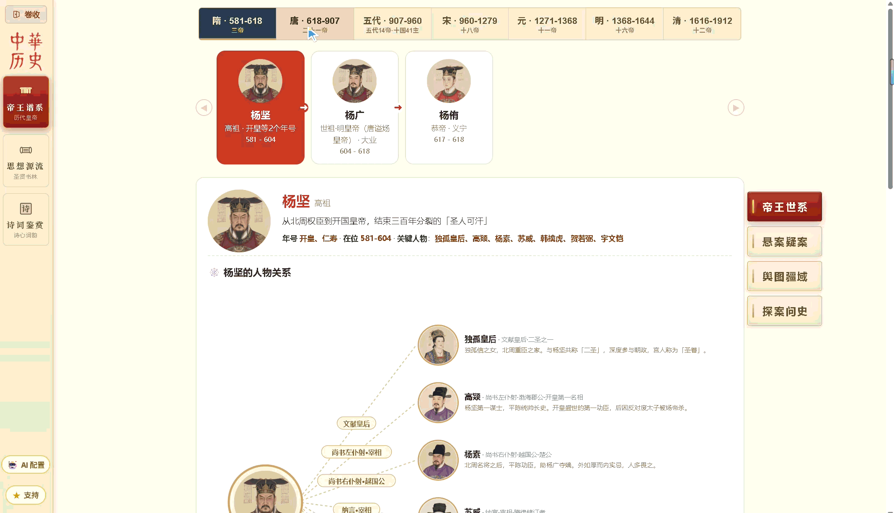
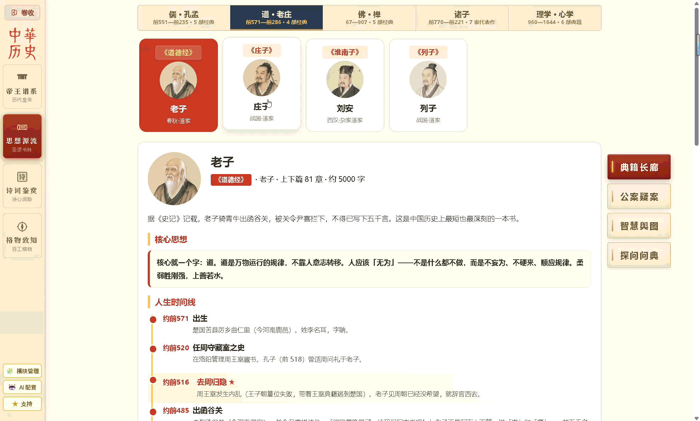
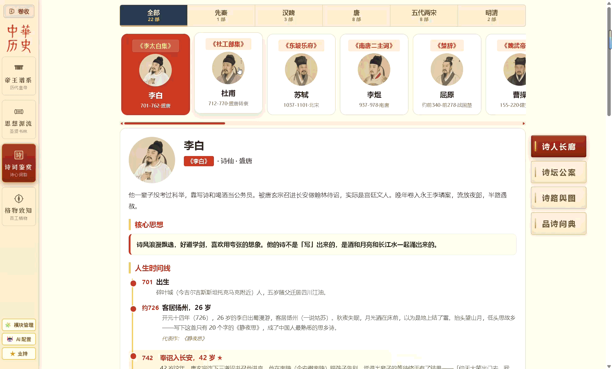
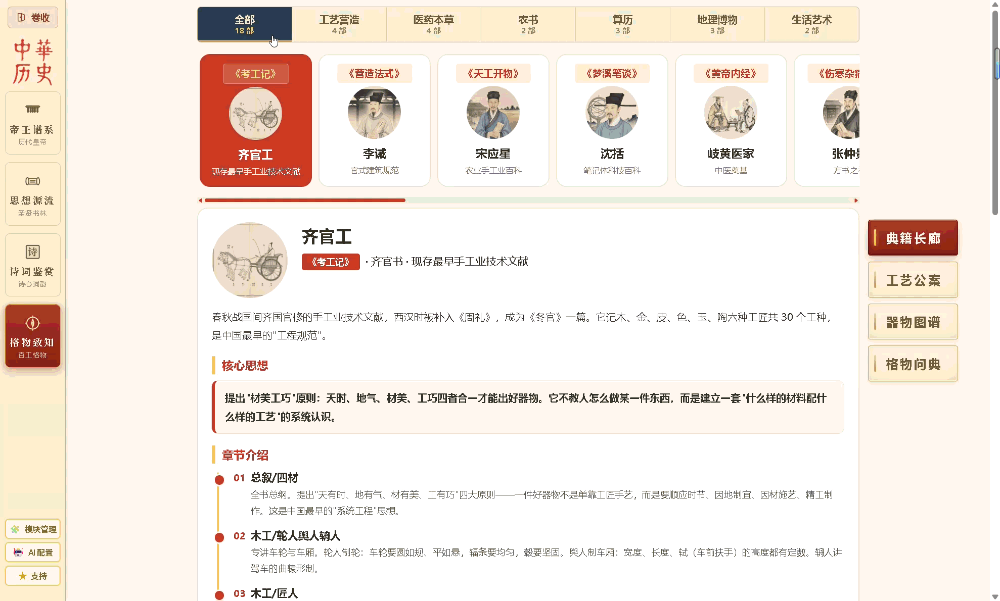
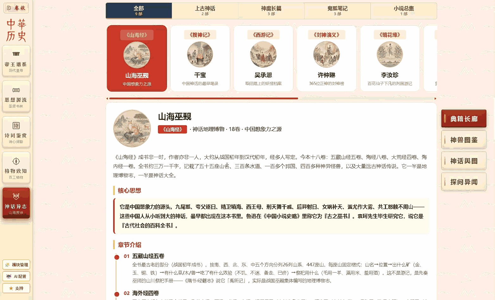
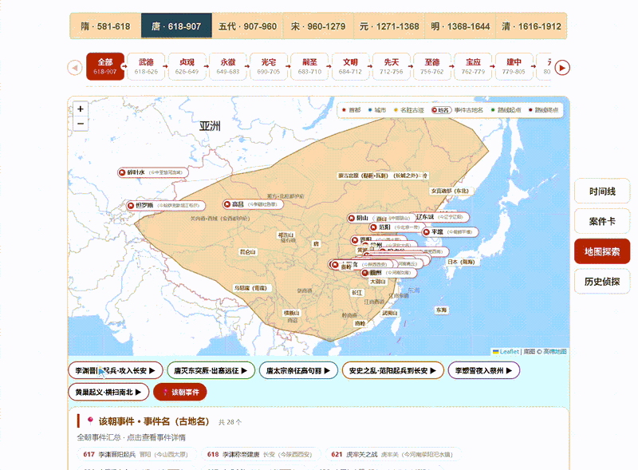
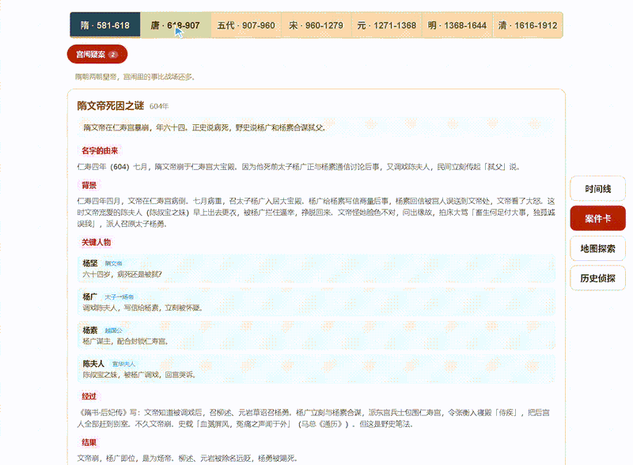
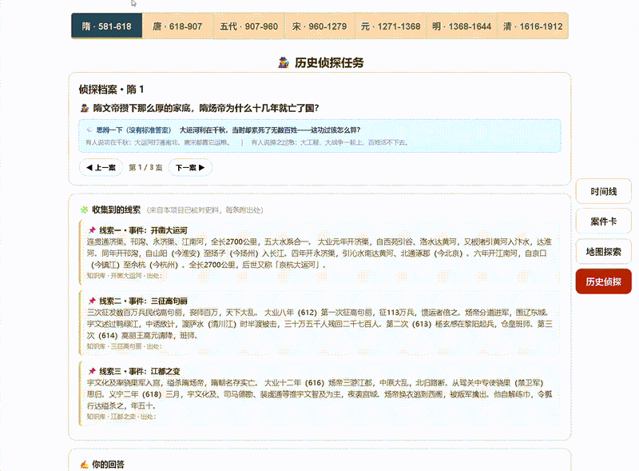

# 🏮 中华历史图谱 · Chinese History Atlas

**帝王谱系 · 思想源流 · 诗词鉴赏 · 格物致知 · 神话异志 —— 五条线并排展开，把一个时代的权力、思想、审美、工艺与想象，重新接回同一张网里。**


🌐 **在线演示**：[https://zinging.github.io/chinese-history-atlas/web/](https://zinging.github.io/chinese-history-atlas/web/)

> 📖 不需要任何账号，打开就是一个**可交互的国学知识库**：会动的疆域地图、八段式悬案档案、侦探式思辨问答、按原著还原的古舆图，以及 800 余张统一工笔淡彩风格的插图。

---

## 🧭 这个站想解决什么

学历史最常见的挫败是：年代表背了又忘，皇帝、思想家、诗人、工匠、神话各记各的，脑子里始终是一堆散点。

可在真实的历史里，它们从来不是散的——

**王安石在朝堂上推行变法时，程朱理学正在回应同一套时代困局；苏轼正走在贬谪的路上写下「大江东去」；《营造法式》的工匠们在汴梁城里起高楼；而宋人在志怪里安顿自己对未知的想象。**

这个站把**帝王、思想、诗人、工匠、神话**五条线并排摊开：你看到的不再是孤立的人名和年份，而是一个时代的因果与全貌。

- 想系统梳理朝代脉络的历史爱好者，能在这里立起时间坐标；
- 想入门传统文化的人，能沿着儒释道看清思想如何流变；
- 学生可以从「背年代」转向「理解因果」；
- 对科技史感兴趣的人，能从《考工记》一路读到《天工开物》《本草纲目》；
- 着迷于神话世界的人，能跟着《山海经》走到昆仑之丘、跟着唐僧走到雷音寺、跟着姜子牙走到牧野战场。

---

## 🗺️ 五大板块

### 🏮 一、帝王谱系 · 七朝权力的现场

`帝王世系` · `悬案疑案` · `舆图疆域` · `探案问史`

从隋到清，**7 朝 77 位皇帝**（隋 3 · 唐 14 · 五代 6 · 宋 18 · 元 8 · 明 16 · 清 12），一条横向卡片流贯穿一千三百年。点开任一皇帝，不是一段百度式简介，而是完整的「一生现场」：

- **帝王世系**：每位皇帝配**生平时间线（共 562 条）**、君臣后妃与对手关系、冷知识、争议话题，★ 标出重大转折；
- **悬案疑案**：**36 件**著名疑案，每件拆成八段——名称由来 → 时代背景 → 涉案人物 → 事件经过 → 结局 → 影响 → 开放讨论 → 史料出处，给你完整推理链而不是一句话结论；
- **舆图疆域**：可缩放地图叠加各朝疆域轮廓与古地名，**靖难南下、郑和下西洋、清军入关**等 **36 条行军航海路线**按时间轴分段动画；点任意古地名即对照今址（如「睦州」≈ 今浙江建德一带）；
- **探案问史**：**77 道史论选择题**（每帝一道），分「论证判断」（如何评价这项政策）与「因果链」（此事因何发生）两类，提交即批改；还有带出处线索的开放案卷，由你自己下判断。

全板块另含 **117 件大事、141 个舆图事件、114 位关键人物小传、29 处古今地名对照**；所有线索标注《旧唐书》《宋史》《明史》等出处，演义说法单独标注「小说演绎，正史不载」。



### 📚 二、思想源流 · 中国人的底层操作系统

`典籍长廊` · `公案疑案` · `智慧舆图` · `探问问典`

**儒（孔孟）、道（老庄）、佛（禅宗）、诸子（兵法 / 法家 / 墨家）、理学心学（朱熹 / 王阳明）**，5 大流派、27 部核心经典，从先秦一路讲到明清。

- **典籍长廊**：结合作者当时的处境读原文，而不是脱离时代死记——读《论语》看见周游列国的窘迫，读《韩非子》看见它如何被自己的逻辑反噬；原文与白话译文（棕字）逐段对照；
- **公案疑案**：**15 件**思想悬案，如「孔子为什么诛杀少正卯」「庄子是真的逍遥还是失败者的自我安慰」，同样八段拆解；
- **智慧舆图**：儒释道的迁徙与传播路线落在地图上，看清思想如何在大地上流转、交锋、合流；
- **探问问典**：**13 道**侦探式追问，把带出处的线索摆给你，不给标准答案。



### 🎋 三、诗词鉴赏 · 先看处境，再读诗

`诗人长廊` · `诗坛公案` · `诗路舆图` · `品诗问典`

从屈原到纳兰性德，**22 位文人**排成一条长廊。这里不做机械背诵，而是**先看诗人一生走到了哪里，再读一首诗背后的处境、心情与公案**：

- **71 篇名篇精读**：每篇四层展开——原文、白话、写作背景、后世点评；专有名词随文注释；
- **95 条金句**：不做摘抄，每句配上人物心境与现实人生的解读。李白为什么在江陵写下「轻舟已过万重山」？因为他刚接到大赦令，劫后余生，船才显得那么快；
- **诗路舆图**：**13 条路线动态连线**，苏轼贬谪、李白漫游、杜甫流寓、岑参出塞……诗人去过哪里、在哪里写下名句，一图看尽；
- 另有 **107 条行迹年表、54 条冷知识、13 场诗坛公案、22 道品诗问典**（如李煜《虞美人》与牵机药之谜）。



### 🧭 四、格物致知 · 古人的科技与手艺

`格致典籍` · `工艺公案` · `器物图谱` · `格物问典`

**17 部古代科技典籍**分六大类铺开——工艺营造（考工记 / 营造法式 / 天工开物 / 梦溪笔谈）、医药本草（黄帝内经 / 伤寒杂病论 / 本草纲目 / 千金要方）、农书（齐民要术 / 农政全书）、算历（九章算术 / 周髀算经 / 授时历）、地理博物（水经注 / 徐霞客游记）、生活艺术（茶经 / 园冶）。

- **器物图谱**：**59 件**代表性器物，博物图谱式工笔白描插图，按书分组、点击可放大细看——后母戊鼎、错金银铜方案、斗拱、活字、水车……；
- **工艺公案**：**12 件**技术史悬案，追问「活字印刷为什么没能普及」「李时珍为什么要花 27 年重修本草」「《考工记》的六齐配比为什么是那个比例」；
- **格物问典**：**14 道**带史料线索的推理题，让你像技术史家一样判断；
- 每部典籍讲透「核心思想 + 章节介绍 + 历史境遇」，看清古代工艺如何一步步演进。



### 🐉 五、神话异志 · 按原著还原的想象力版图

`志怪典籍` · `神兽图鉴` · `神话舆图` · `探问异闻`

**9 部神魔经典**分四类——上古神话（山海经 / 搜神记）、神魔长篇（西游记 / 封神演义 / 镜花缘）、鬼狐笔记（聊斋志异 / 子不语 / 阅微草堂笔记）、小说总集（太平广记）。

- **志怪典籍**：每部书结合作者处境讲，原文与白话译文逐段对照，白话以棕字区分；
- **神兽图鉴**：**113 只神兽精怪**按书收录，统一工笔淡彩——从九尾狐、应龙、白泽、陆吾，到取经路上的各路妖魔；
- **神话舆图**：**5 张纯俯视工笔古舆图、69 个热点**，全部严格依原著文本的方位与地貌绘制，不是现代地图上贴标签：
  - **山海经・想象世界（22 站）**：招摇山、昆仑之丘、不周山、长留山、一目国、长臂国……神山异国该在哪个方位就在哪个方位；
  - **西游记・取经之路（17 难）**：高老庄、流沙河、火焰山、女儿国、小雷音寺、狮驼岭……沿西行次第展开；
  - **封神・战场（14 处）**：朝歌、牧野、昆仑山、汜水关、诛仙阵……还原商周大战的空间格局；
  - **聊斋・夜世界（8 场）**：兰若寺、太原王宅、崂山……跟着狐鬼故事的发生地走；
  - **太平广记・奇闻时空图（8 则）**：黄粱一梦、南柯太守、马嵬驿、普救寺……唐传奇的时空现场；
  - 每个热点都附**原文、白话译文与原著地貌描述**；
- **探问异闻**：8 道开放追问，把「神话为什么这样写」交给你判断。



---

## ✨ 这个项目有什么不同

**🗡️ 五条线并行，而不是五个孤立页面**

皇帝的决策、思想家的回应、诗人在流放路上的句子、工匠在工坊里的发明、先民想象中的神山神迹，本就是同一个文明的五个侧面。这里让你看见权力、思想、审美、工艺与想象如何彼此牵动。

**🗺️ 两套地图，各讲各的空间**

真实历史用 Leaflet 地图：疆域轮廓、古地名今址、行军航海路线按时间轴回放；神话世界则抛弃现代地图，改用**按原著逐点校对的俯视工笔古舆图**——长臂国在东、交胫国在东，火焰山、昆仑山、女儿国该在哪就在哪，想象的归想象，绝不拿现代地图冒充山海经。

| 舆图疆域：路线按时间轴回放 | 悬案疑案：八段式完整推理链 |
| :---: | :---: |
|  |  |
| **探案问史：带出处的线索交给你判断** | **帝王世系：时间线与关系图** |
|  |  |

**📂 案件式深读，而不是百科式罗列**

全站 **76 件案件档案**（帝王 36 + 思想 15 + 诗词 13 + 格物 12），全部按「名称由来 → 背景 → 人物 → 经过 → 结果 → 影响 → 开放讨论 → 史料出处」八段组织。给你的是完整推理过程，而不是「某某年发生某事」的一句话。

**🕵️ 侦探式问典，而不是背题**

全站 **57 道问典题**（思想 13 + 诗词 22 + 格物 14 + 神话 8），像侦探游戏一样：先抛出案子，再逐条给出**标注了出处的线索**，最后留出没有标准答案的思辨题和作答区——另有帝王谱系 **77 道史论选择题**（论证判断 + 因果链两类），提交即批改。

**📖 原文与白话对照，而不是只给结论**

经典、诗词、舆图热点都保留原文原话，紧跟一段白话译文（棕字区分）；既读到古人的原话，又能立刻读懂。

**🔍 演义与正史分开，线索可溯源**

时间线与侦探线索均标注《旧唐书》《宋史》《明史》等出处；演义传说单独标注「小说演绎，正史不载」；神话内容严格忠于原著文本——不让你把《三国演义》当正史读，也不让想象图冒充山海经原文。

**🖼️ 800 余张工笔插图，是统一画风，不是模板皮肤**

全站统一宣纸米黄、朱红印章、工笔淡彩视觉：113 只神兽、59 件器物、163 张帝王与人物像、5 张古舆图，全部为同一画风手绘生成；古地图按原著方位与地形特征逐点校对。

**⚡ 零依赖、秒打开，离线也能用**

纯原生 HTML / CSS / JS，无构建、无框架、无后端，`data/` 全是可读可改的 JSON，无需 `npm install`、无需数据库；地图库与字体全部本地化，断网照常运行。页面还做了**工程级懒加载**：JSON 按板块分片、切到才拉；图鉴和舆图卡片走缩略图（480 / 800px），点开才取原图，缺失自动回退；地图库仅在需要的页面初始化。

**🤖 AI 讲解员开箱即用，数据不出本机**

内置零依赖 MCP Server，豆包 / Hermes 等客户端一行配置接入：AI 只读站内数据、不联网，回答带深链直达页面；倒排索引毫秒级检索。另有网页内 OpenAI 兼容接口（DeepSeek / OpenAI 等），配置仅存于本机 `web/llm-config.json`（已 gitignore），问答内容不上传任何服务器。

---

## 📊 数据规模

| 板块 | 核心内容 |
| --- | --- |
| 🏮 帝王谱系 | 7 朝 77 帝 · 562 条生平时间线 · 117 件大事 · 141 个舆图事件 · 114 位人物 · 36 件悬案 · 77 道史论题 · 36 条行军航海路线 · 29 处古今地名 |
| 📚 思想源流 | 儒 / 道 / 佛 / 诸子 / 理学心学 5 大流派 · 27 部经典 · 15 件公案 · 13 道问典 · 3 条思想传播路线 |
| 🎋 诗词鉴赏 | 22 位文人 · 71 篇名篇精读 · 95 条金句 · 107 条行迹年表 · 13 场诗坛公案 · 13 条诗路 · 22 道问典 |
| 🧭 格物致知 | 17 部典籍（六大类） · 59 件器物图谱 · 12 件工艺公案 · 14 道问典 |
| 🐉 神话异志 | 9 部经典（四大类） · 113 只神兽图鉴 · 5 张古舆图 69 个热点 · 8 道探问 |
| **全站合计** | **76 件八段式案件档案 · 57 道侦探问典 · 77 道史论选择题 · 802 张工笔插图与地图（含缩略图）** |

*疆域据谭其骧《中国历史地图集》手绘简化示意；画像、器物、神兽与古舆图为统一工笔淡彩风格生成，神话舆图严格依原著文本的方位与地貌绘制。*

---

## 🧭 可以怎么学

| 你的目标 | 推荐路径 |
| --- | --- |
| 建立朝代框架 | 通读七朝帝王顺序，先立起「隋 → 唐 → 五代 → 宋 → 元 → 明 → 清」的大坐标 |
| 看懂重大事件 | 在舆图疆域按年号筛选，看靖难、下西洋、清军入关一场战役从哪起、打到哪 |
| 训练史论思辨 | 每个朝代进探案问史，先做因果链选择题，再挑战开放案卷 |
| 梳理思想脉络 | 从孔孟到朱王，看儒释道如何相互影响、流变与合流 |
| 结合处境读诗 | 先看诗人一生行迹，再读名篇精读与金句背后的心境 |
| 看科技与工艺 | 从《考工记》六齐配比到《天工开物》造纸制瓷，进器物图谱点开看细节 |
| 走进神话世界 | 沿山海经 22 站、西游 17 难、封神 14 战场、聊斋 8 场、太平 8 则走一遍古舆图 |
| 古今地名对照 | 点地图上任意古地名，看它今天对应哪里 |

---

## 🚀 快速开始

环境要求：**Node.js 18+**（自带 `fetch`，无需 `npm install`）。

```bash
git clone git@gitee.com:chen_ye_code/chinese-history-atlas.git
cd chinese-history-atlas
node web/serve.mjs
# 然后浏览器打开 http://127.0.0.1:5173/web/
```

- 💡 端口被占用：运行 `node web/serve.mjs 8080` 即可换端口。
- ⚠️ 请用本地服务器打开，**不要直接双击 HTML**：前端通过 `fetch` 读取 `data/*.json`，`file://` 方式会被浏览器 CORS 拦截，导致页面空白。
- 🤖 **可选・接入 AI 老师**：在探案问史页底部打开「🤖 AI 老师配置」，填入 OpenAI 兼容接口、Key 与模型（点 ⬇ 可自动拉取模型列表）。配置仅存于本机 `web/llm-config.json`（已 gitignore）；仓库附带带注释的 `web/llm-config.json.template`，复制改名即可。

---

## 🤖 AI 讲解员（MCP 连接器，开箱即用）

项目内置一个**零依赖 MCP Server**（`web/tools/history-mcp-server.mjs`，15 个只读工具）。接入豆包 / Hermes / Cursor / Claude Desktop 等任意 MCP 客户端后，AI 就是这座展厅的讲解员：**只检索站内数据、不联网**，回答问题时自动给出深链，右侧浏览器直接打开对应页面——讲土木堡之变就定位到地图事件，问高老庄就落到神话舆图热点。

- **一键生成配置**：项目根目录执行 `npm run mcp:install`（Windows；macOS/Linux 用 `bash web/tools/install-mcp.sh`），路径自动解析、配置 JSON 自动复制到剪贴板；Cursor / Zed 打开项目时直接识别根目录自带的 `.mcp.json`（相对路径）。
- **新会话零命令行开场**：MCP 自己探活、未运行时自己在后台拉起网站（脱离 MCP 独立存活，约 0.8 秒就绪），AI 直接打开 `http://127.0.0.1:5173/web/` 即待命——不搜硬盘、不拼路径、无需手动点任何脚本。
- **一键开场提示词**：连接器内置「开场：打开中华历史图谱」「按站内内容讲解」两个 prompts 模板，新会话点一下即可锁定正确流程（详见配置文档第六节）。
- **毫秒级检索**：内置单字/双字倒排索引，首次建索引约 230ms，之后每次检索 1–2ms；「土木堡之变」「兰若寺」「高老庄」「昆仑之丘」等直达对应地图事件或舆图热点。
- **双地址**：每条结果同时带本地 `url`（可直接导航）与 GitHub Pages `online_url`（可分享）。
- 完整配置说明见 [`docs/AI集成-本地MCP配置.md`](docs/AI集成-本地MCP配置.md)；自检 `npm run mcp:selftest`。

---

## 🏗️ 项目结构

```
chinese-history-atlas/
├── data/                  # 知识层（JSON，全部可读可改）
│   ├── sui/ tang/ wudai/ song/ yuan/ qing/   # 六朝帝王数据（明在顶层目录）
│   ├── emperors/          # 明朝皇帝卡片
│   ├── cases/ events/ places/ routes/ people/ quiz/  # 明朝各数据集
│   ├── rujia/ daojia/ foxue/ zhuzi/ lixue/   # 思想源流五流派
│   ├── shiwen/            # 诗词鉴赏：22 位诗人（index + books/ 分片）
│   ├── gewu/              # 格物致知：17 部典籍 · 器物 · 公案 · 问典
│   ├── myth/              # 神话异志：9 部典籍 · 神兽 · 舆图路线 · 探问
│   ├── boundaries/        # 各朝疆域 GeoJSON
│   ├── portraits/         # 人物头像、器物/神兽工笔插图、古舆图（含缩略图）
│   └── schema/ sources/   # 数据结构与史料出处
├── web/                   # 前端：纯原生 HTML/CSS/JS
│   ├── index.html         # 帝王谱系主页
│   ├── guoxue/            # 思想源流 · 诗词鉴赏 · 格物致知 · 神话异志
│   ├── tools/             # MCP Server（AI 讲解员）、缩略图生成、题库生成与校验脚本
│   └── vendor/            # Leaflet 本地化，无 CDN
├── scripts/               # 数据校验与维护脚本
└── docs/                  # 封面 / 演示动图 / 内容规范
```

---

## 📖 内容规范

- **史实优先**：只讲有史料依据的内容；存疑处明说「没有确切记载」；演义传说标注「小说演绎，正史不载」。
- **原著优先**：经典、诗词、神话保留原文，紧跟白话译文；神话舆图与热点严格忠于原著文本。
- **通俗表达**：短句口语，专有名词首现时括号解释（如「幽云十六州（今北京、天津及山西、河北北部一带）」）。
- **学习者为主导**：开放问题不设标准答案，先留思考空间再补史实；选择题正确项打散位置，避免靠位置猜答。
- **中立立场**：不站队、不美化，争议话题呈现多方观点后交由学习者自行判断。

---

## 📄 许可

[MIT License](LICENSE) © chen_ye_code

正史内容以《隋书》《旧唐书》《新唐书》《宋史》《元史》《明史》《清史稿》等为主要依据；神话内容以《山海经》《搜神记》《西游记》《封神演义》《镜花缘》《聊斋志异》《子不语》《阅微草堂笔记》《太平广记》原著文本为准。疆域轮廓为手绘简化示意，非精确边界；画像、器物、神兽与古舆图为工笔淡彩风格示意，非历史真实画像；地图底图 © 各瓦片服务商，Leaflet © Leaflet Contributors。
