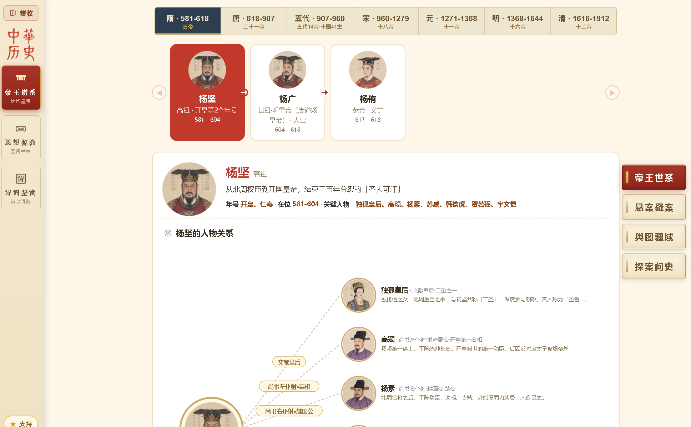
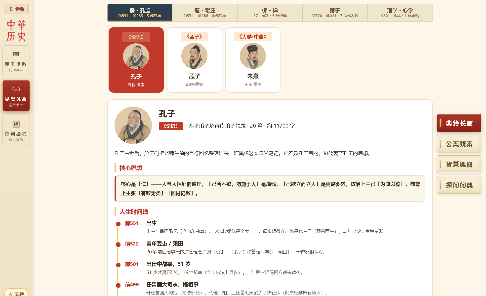
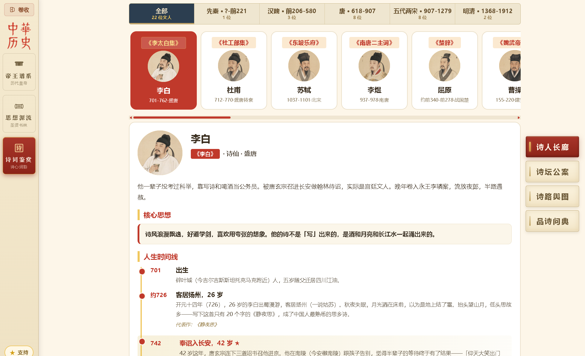

# 🏮 中华历史图谱・Chinese History Atlas

> 中文 |
> [English](README_EN.md)

一个把 **帝王谱系・思想源流・诗词鉴赏** 三大板块串在一起的中国文化学习站。

不是教材复读机，也不是百科网站 —— 它做的是一件事：**把散落的知识点连成线**。皇帝做了什么、思想家怎么看、诗人在那个节点写下了什么，三条线同时展开，你自己拼出一个时代的完整轮廓。

适合历史爱好者系统梳理朝代脉络、传统文化入门者建立思想坐标，也适合学生从 "背年代" 转向 "理解因果"。

**🌐 在线演示**


* GitHub Pages：[https://zinging.github.io/chinese-history-atlas/web/](https://zinging.github.io/chinese-history-atlas/web/)

* Gitee Pages：[https://chen\_ye\_code.gitee.io/chinese-history-atlas/web/](https://chen_ye_code.gitee.io/chinese-history-atlas/web/)


***

## 🗺️ 三大板块——帝王谱系、思想源流、诗词鉴赏

### 🏮 帝王谱系

从隋到清七朝 77 位皇帝，横向卡片流。点开看生平时间线、人物关系图、冷知识与争议话题。地图叠加各朝疆域轮廓、古地名点、行军与航海路线动画。悬案疑案逐案拆解 —— 从 "名称怎么来的" 到 "到底谁该负责"，再到开放讨论。探案问史让你拿带出处的线索自己下判断。




### 📚 思想源流

儒（孔孟）、道（老庄）、佛（禅宗）、诸子（兵法 / 法家 / 墨家）、理学心学（朱熹 / 王阳明）—— 中国人的底层操作系统，从先秦一路到明清。每个流派选经典文本，**结合作者当时的处境读原文**，而不是脱离时代死记。再用辩证选择题训练思辨：一道题同时考 "怎么评价" 和 "因果链是什么"。




### 🎋 诗词鉴赏

从屈原到纳兰性德，按朝代编排 22 位文人。不只是背诗 ——**看诗人一生行迹地图，读一首诗背后是什么处境、什么心情、什么公案**。为什么李白在江陵写 "轻舟已过万重山"？因为他刚接到大赦令。诗路舆图标出他们去过哪里、在哪里写下名句。





***

## ✨ 这个项目有什么不同

### 三条线并行，不是三个孤立页面

皇帝在朝堂上做的决策、思想家在书斋里的回应、诗人在流放路上写下的句子 ——**同一个时代的三个侧面**。传统历史网站只讲帝王，这个站让你同时看到权力、思想和审美怎么互相影响。

### 历史落地在地图上，不是文字里

Leaflet 可缩放底图叠各朝疆域轮廓与古地名点。靖难之役的南下路线、郑和七下西洋、清军入关 —— 按时间分段动画播放，不是静态图。点任何古地名看今址对照（"睦州"= 今浙江建德一带）。

### 案件式深读，不是百科式罗列

著名疑案拆成八段：名称由来 → 背景 → 人物 → 经过 → 结果 → 影响 → 开放讨论 → 史料出处。给你完整的推理链条，而不是 "某某年发生了某事" 的一句话。

### 380 道辩证题，不是是非题

内置 **77 位皇帝共 380 道选择题**，分两类：


* **论证判断**："你怎么评价这个人的某政策？"

* **因果链**："这件事为什么发生？直接原因是什么？"

提交即批改附解析。约四分之一为开放题，可接 AI 老师点评。

### 线索可溯源，演义和正史分开

时间线与侦探线索标注《旧唐书》《宋史》《明史》等出处。演义 / 传说单独标注 "小说演绎，正史不载"，不让你把《三国演义》当正史读。

### 零依赖，打开就能用

纯原生 HTML/CSS/JS，无构建、无框架、无后端。`data/` 全是可读 JSON—— 你可以直接打开看、改、加。不需要 npm install，不需要数据库。

### 可接 AI 私教，数据不出本机

内置 OpenAI 兼容接口（DeepSeek / OpenAI 等），配置只存本机 `web/llm-config.json`（已 gitignore）。你的提问和回答不上传任何服务器。


***

## 🧭 可以怎么学


| 方向     | 你可以做什么                   |
| ------ | ------------------------ |
| 建立朝代框架 | 通读七朝皇帝顺序，先有「唐→五代→宋」的大坐标  |
| 理解关键人物 | 点进任一皇帝，看人物关系图（君臣、后妃、对手）  |
| 看懂重大事件 | 在地图上按年号筛选，看一场战役从哪开始、打到哪  |
| 梳理思想脉络 | 从孔孟到朱王，看儒释道怎么互相影响、怎么流变   |
| 结合处境读诗 | 看诗人一生行迹，再读他在那个节点写下的句子    |
| 训练思辨   | 辩证选择题：一道题同时考「怎么评价」和「因果链」 |
| 古今地名对照 | 点古地名看今址（如「睦州」= 今浙江建德一带）  |


***

## 🚀 快速开始

环境要求：**Node.js 18+**（自带 `fetch`，无需 `npm install`）。


```
git clone git@gitee.com:chen_ye_code/chinese-history-atlas.git
cd chinese-history-atlas
node web/serve.mjs
# 浏览器打开 http://127.0.0.1:5173/web/
```

> 端口被占用就换：
> `node web/serve.mjs 8080`
> 。
> 为什么必须起本地服务器？前端通过
> `fetch`
> 读
> `data/*.json`
> ，直接双击 HTML 会被浏览器 CORS 拦截、页面空白。

**可选・接入 AI 老师**：探案问史页底部「🤖 AI 老师配置」→ 填 OpenAI 兼容接口 + Key + 模型（点 ⬇ 自动拉取列表）。配置只存本机 `web/llm-config.json`（已 gitignore），仓库附了带注释的 `web/llm-config.json.template`，复制改名即可填写。


***

## 🏗️ 项目结构


```
chinese-history-atlas/
├── data/                  # 知识层（JSON，全部可读可改）
│   ├── sui/ tang/ wudai/ song/ yuan/ ming/ qing/   # 七朝帝王谱系
│   │   ├── emperors/      # 皇帝卡片（生平、时间线、人物、冷知识）
│   │   ├── events/        # 该朝大事
│   │   ├── cases/         # 悬案疑案档案
│   │   ├── places/        # 古地名（含今地名对照、经纬度）
│   │   ├── routes/        # 行军/航海路线
│   │   ├── quiz.json      # 史论工坊选择题题库
│   │   └── people.json    # 关键人物小传
│   ├── boundaries/        # 各朝疆域 GeoJSON
│   ├── portraits/         # 人物头像（AI 生成工笔风）
│   └── schema/ sources/   # 数据结构与史料出处
├── web/                   # 前端：纯原生 HTML/CSS/JS
│   ├── index.html         # 帝王谱系主页
│   ├── guoxue/            # 思想源流 + 诗词鉴赏
│   ├── tools/             # 题库生成与校验脚本
│   └── vendor/            # Leaflet 本地化，无 CDN
├── scripts/               # 数据校验与维护脚本
└── docs/                  # 架构 / 内容规范 / 演示动图
```


***

## 📊 数据规模


| 板块   | 内容                           |
| ---- | ---------------------------- |
| 帝王谱系 | 7 朝 77 位皇帝、380 道史论题、545 条时间线 |
| 思想源流 | 儒道佛诸子理学心学 6 大流派、27 部经典       |
| 诗词鉴赏 | 22 位文人、按朝代编排、诗路行迹地图          |

疆域据谭其骧《中国历史地图集》手绘简化示意；画像为 AI 生成工笔风格。


***

## 📖 内容规范


* **史实优先**：只讲有史料依据的内容；拿不准明说「没有确切记载」；演义 / 传说标注「小说演绎，正史不载」。

* **通俗表达**：短句口语、专有名词首现时括号解释（如「幽云十六州（今北京、天津及山西、河北北部一带）」）。

* **学习者当导演**：开放问题没有标准答案，先给思考空间再补史实；选择题的正确项打散位置，避免靠位置猜答案。

* **中立立场**：不站队、不美化，争议话题呈现多方观点后让学习者自己判断。


***

## 📄 许可

[MIT License](LICENSE) © chen\_ye\_code

内容以正史为主要依据（《隋书》《旧唐书》《新唐书》《宋史》《元史》《明史》《清史稿》等）；疆域轮廓为手绘简化示意，非精确边界；画像为 AI 生成工笔风格示意，非历史真实画像；地图底图 © 各瓦片服务商，Leaflet © Leaflet Contributors。