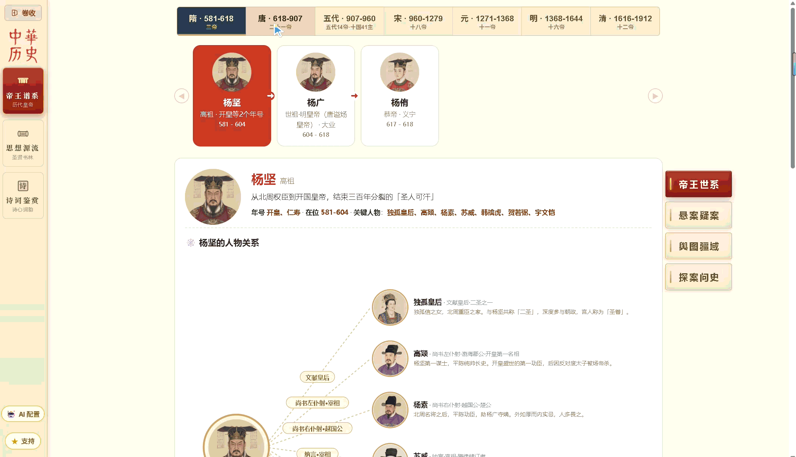
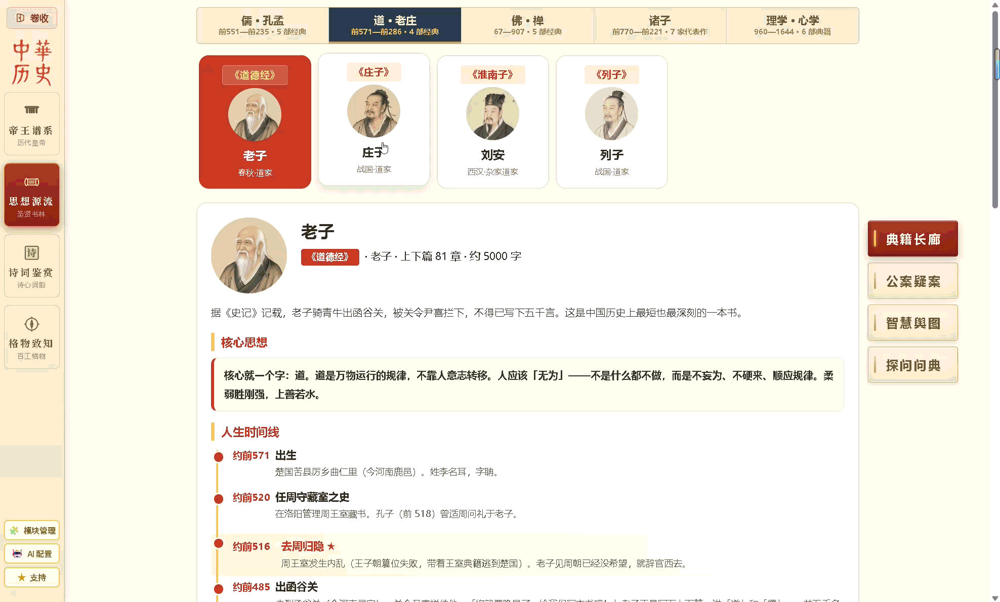
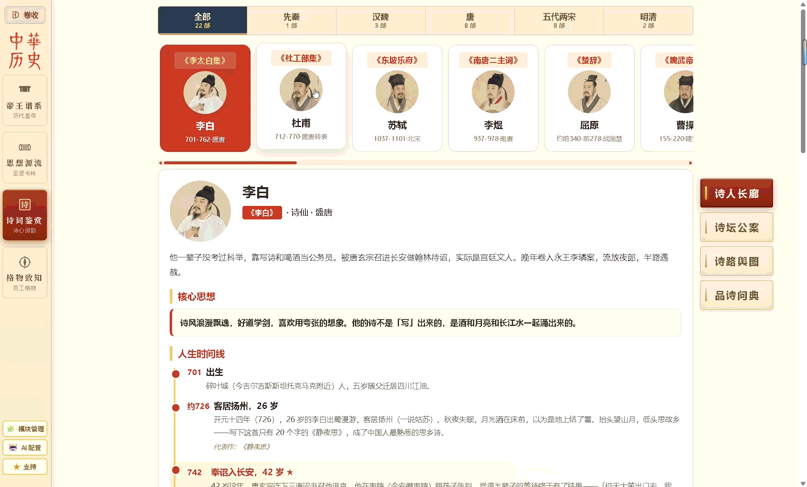
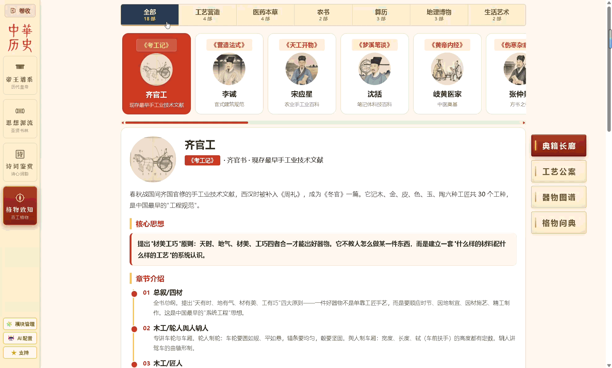
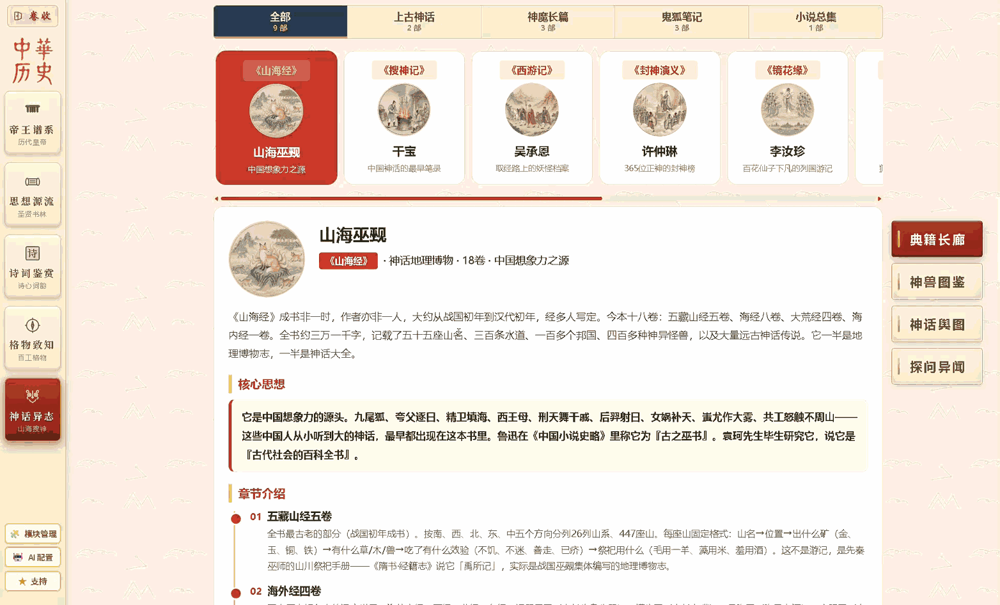
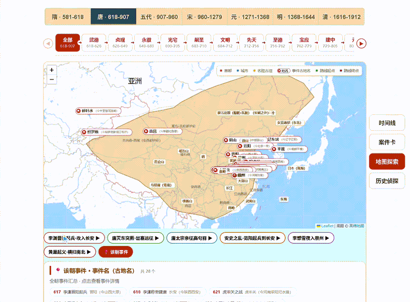
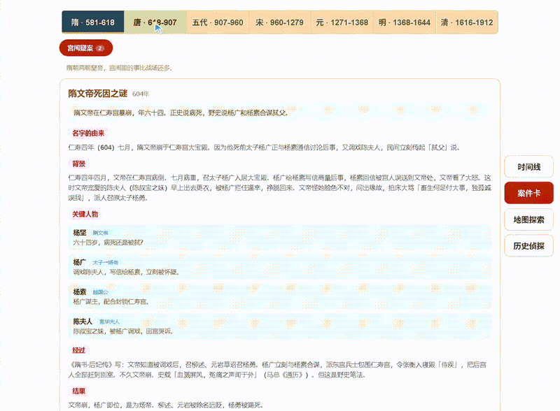
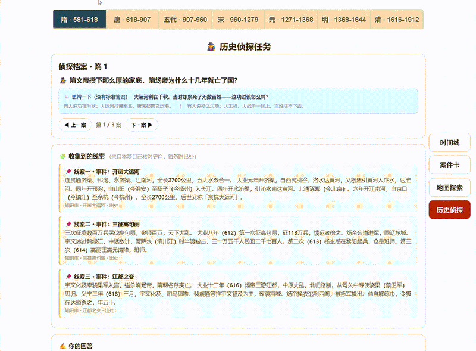

<!-- Do not wrap the heading in an outer <div>: GitHub does not parse Markdown
     inside HTML block elements, which makes # and ** render as literal text.
     Use self-aligned HTML tags instead, which stay centered without breaking parsing. -->
<h1 align="center">🏮 Chinese History Atlas</h1>

<p align="center"><b>Emperor Lineage · Thought Origins · Poetry Appreciation · Natural Sciences · Myth & Legend — five threads side by side, reconnecting the power, thought, aesthetics, craft and imagination of one era into a single web</b></p>

<p align="center">


</p>

<p align="center">🌐 <b>Live demo</b>: <a href="https://zinging.github.io/chinese-history-atlas/web/">https://zinging.github.io/chinese-history-atlas/web/</a></p>

---

> An **interactive knowledge base of Chinese civilization** you open and start using: animated territory maps, ancient maps reconstructed from the original texts, eight-section case files, detective-style reasoning questions, and 784 original gongbi (fine-brush) illustrations in one consistent style. No account, no internet, one command to run after cloning.

## 🧭 The problem this solves

The most familiar frustration in learning history: you memorize the timeline and forget it, while emperors, thinkers, poets, craftsmen and myth-makers each stay in their own drawer — a pile of disconnected dots.

In real history they were never separate. **While Wang Anshi pushed his reforms at court, Neo-Confucians were answering the same crisis; Su Shi was writing "the great river flows east" on the road into exile; craftsmen were raising timber halls in Kaifeng under the Yingzao Fashi; and Song writers were settling their imagination of the unknown into ghost stories.**

This site lays the **five threads — emperors, thinkers, poets, craftsmen, myth — side by side**, so what you see is not isolated names and dates but the causes and shape of an era.

- history buffs can build a firm chronological frame;
- newcomers to traditional culture can trace how Confucianism, Buddhism and Daoism evolved;
- students move from "memorizing dates" to "understanding cause and effect";
- anyone curious about the history of science can follow from *Kao Gong Ji* through *Tiangong Kaiwu* and *Bencao Gangmu*;
- myth lovers can walk with the *Shanhaijing* to Kunlun, with the Tang monk to Vulture Peak, and with Jiang Ziya to the Muye battlefield.

---

## 🚀 Install

### 1. Just look — install nothing

Open the live demo: [https://zinging.github.io/chinese-history-atlas/web/](https://zinging.github.io/chinese-history-atlas/web/)

No Node, no clone, no config.

### 2. Full site + AI guide (recommended)

The guide works by **"AI hands you a deep link → you open it → it keeps narrating"**: the AI searches local data and gives you a link that jumps straight to a specific emperor, route or line of poetry, plus the matching illustration; once you open it, it continues along that page's order.

> The AI **cannot see your screen and never drives a browser** — all it does is get the link and the illustration right. Where the link opens makes no difference: a side panel in DSH or Doubao, or your default browser. The narration always follows the page you actually opened.

#### Path A — generic MCP: any MCP-capable client (recommended)

Doubao / Cursor / Claude Desktop / Hermes / Codex all take this path. It does not depend on DSH's plugin mount layer, so it is **independent of your DSH version**.

```bash
# Requires Node.js 18+, and git on PATH (for the clone below)
# Gitee (fast in China); GitHub mirror: https://github.com/zinging/chinese-history-atlas.git
git clone --depth 1 https://gitee.com/chen_ye_code/chinese-history-atlas.git
cd chinese-history-atlas
node web/serve.mjs          # then open http://127.0.0.1:5173/web/
```

Then run `npm run mcp:install` in the project root (Windows; on macOS/Linux use `bash web/tools/install-mcp.sh`) — paths are resolved automatically and the config JSON is copied to your clipboard. Cursor / Zed pick up the bundled `.mcp.json` as soon as you open the project.

#### Path B — DSH plugin: saves those two steps, but binds to the DSH plugin layer

> ✅ **Published**: `@chenye123/chinese-history-atlas@1.6.0` ([npm](https://www.npmjs.com/package/@chenye123/chinese-history-atlas)). Search "中华历史图谱" in the plugin marketplace, or run `npm i @chenye123/chinese-history-atlas`. The marketplace index lags a little; if search comes up empty, do the self-check in item 3 below, or just use Path A.

The plugin automates "clone + serve": install it, ask a question, and it answers from its bundled data copy, pulls the full site on first use, and starts the local web service in the background.

The published package is the **slim build** (2.7MB / 240 files: the 9.2MB data JSON only, without the 547 images), so it does not hit the upload failures the 29.5MB full build runs into on Chinese networks. The only cost: for the minute or two before the site clone finishes you get text plus image links, and illustrations return as soon as the clone completes.

It goes through DSH's **plugin mount layer** (`cordis.patch.yml`), which is not guaranteed across versions. Check three things first:

- **Tested on**: DSH Desktop Beta 2.0.22-beta.1 · kernel 0.2.2-rc.x. Other versions are untested.
- **Version checks will not stop you**: the bundled `engines.dsh` says `>=0.2.0-rc.2 <0.2.2-beta.1`, but that field is never validated at install time — falling outside it rarely errors; more likely it **silently does nothing** (plugin present, tools missing).
- **Self-check after install**: a new session shows **15 `mcp__atlas__*` tools**, and the startup log contains no `ERR_PACKAGE_PATH_NOT_EXPORTED`.

> If the marketplace cannot find it, or the AI never touches the tools after install, **switch to Path A** — same features, two extra commands.
> Path B also needs `git` on PATH (the automatic site fetch uses `git clone`).

> **Node.js 18+** (built-in `fetch`; no `npm install`). `--depth 1` takes only the latest commit, about 155MB (145.6MB of that is images); fully offline afterwards.
> Port in use: `node web/serve.mjs 8080`.
> Open it through the local server, **never by double-clicking the HTML**: the frontend reads `data/*.json` via `fetch`, and `file://` is blocked by CORS, leaving a blank page.

### Too lazy to do it yourself? Let an AI install it

Send this to your AI client — DSH, Doubao, Cursor, Claude Desktop all work — and it will read the README and walk through the details:

> Install Chinese History Atlas for me: first read the “Install” section of the README at github.com/zinging/chinese-history-atlas, install it as described, then tell me how to start using it.

---

## 🗺️ Five modules

### 🏮 1. Emperor Lineage — power on stage, seven dynasties

`Dynasty Lineage` · `Unsolved Cases` · `Territory Maps` · `History Detective`

**7 dynasties, 77 emperors** (Sui 3 · Tang 14 · Five Dynasties 6 · Song 18 · Yuan 8 · Ming 16 · Qing 12) on a single horizontal card rail spanning 1,300 years. Open any emperor for a full "life on scene", not an encyclopedia stub:

- **Dynasty lineage**: a **562-entry life timeline**, ministers / consorts / rivals, fun facts and controversies, with ★ marking the turning points;
- **Unsolved cases**: **36** famous mysteries (Ming 12 · Tang 5 · Song 7 · Yuan 3 · Qing 4 · Five Dynasties 3 · Sui 2), each broken into eight sections — naming → background → people → course → outcome → impact → open debate → sources — giving you a full chain of reasoning instead of a one-line verdict;
- **Territory maps**: a zoomable Leaflet map overlaying each dynasty's approximate borders and ancient place names, with **36 campaign and voyage routes** — the Jingnan campaign, Zheng He's voyages, the Qing entry through Shanhai Pass — animated in time order; click any ancient place for its modern equivalent (e.g. Muzhou ≈ modern Jiande, Zhejiang); **141 map events** each open a card with an illustration and a full narrative;
- **History Detective**: **77 critical-choice questions** (one per emperor) in two kinds — "how do you assess this policy" and "why did this happen" — graded instantly; plus open dossiers with sourced clues where you reach your own verdict.



### 📚 2. Thought Origins — the operating system of Chinese thought

`Classics Gallery` · `Thought Cases` · `Routes of the Sages` · `Inquiry`

**Confucianism, Daoism, Chan Buddhism, the Hundred Schools (military / Legalist / Mohist), and Neo-Confucianism / Yangmingism** — 5 schools, 27 core classics, from the pre-Qin through Ming-Qing.

- **Classics Gallery**: **63 close readings across 27 classics**, read against the author's actual situation rather than memorized in a vacuum — read the *Analects* and you see the embarrassment of a wandering job-seeker; read *Han Feizi* and you see how it was undone by its own logic; original text and plain translation paragraph by paragraph;
- **Thought cases**: **15** intellectual mysteries, e.g. "why did Confucius execute Shao Zhengmao", "was Zhuangzi truly free, or consoling a failure" — again in eight sections;
- **Routes of the Sages**: **24 routes with 82 waypoints** laid on the map — Confucius touring the states, Xuanzang heading west, Zhu Xi from the Ehu debate to White Deer Grotto, Wang Yangming from Longchang awakening to crushing Prince Ning. Every waypoint has **six layers**: what happened → the original line from the record → plain translation → source → historical significance → route commentary. Another **51 ancient place names** and **38 Chronicles of the Hundred Schools** (key events of thought spreading and schools forming, with original text, translation and four readings of significance) are pinned on the map, each opening an illustrated card;
- **Inquiry**: **13** detective-style prompts that hand you sourced clues and no standard answer.



### 🎋 3. Poetry Appreciation — see the situation first, then read the poem

`Poets Gallery` · `Poetry Cases` · `Poetry Routes` · `Inquiry`

From Qu Yuan to Nalan Xingde, **22 poets** on one rail. No rote memorization — **first see where a life actually went, then read what stood behind a single poem**:

- **71 close readings**, four layers each — original, plain translation, writing context, later commentary; proper nouns annotated inline;
- **95 golden lines**, each with the poet's state of mind and what it means for a real life. Why did Li Bai write "a light skiff has sailed past ten thousand mountains" at Jiangling? He had just received the amnesty order — spared and heading home, the boat felt that fast;
- **Poetry Routes**: **13 animated routes** — Su Shi's exiles, Li Bai's wanderings, Du Fu's drift, Cen Shen's frontier — where they went and where the famous lines were written, in one view;
- **Life events**: **44 key events** in the poets' lives (two per poet across 22 poets), covering background, key figures, place, course and outcome, plus the poem's original text and translation; clicking an event pins its location on the map and opens an illustrated card;
- plus **107 chronology entries, 54 trivia, 13 poetry cases, 22 inquiry prompts** (e.g. Li Yu's *Yu Mei Ren* and the qianji-poison mystery).



### 🧭 4. Natural Sciences — ancient technology and craft

`Classics` · `Craft Cases` · `Artifact Gallery` · `Inquiry`

**17 ancient scientific and technical classics** in six categories — craft and architecture (*Kao Gong Ji*, *Yingzao Fashi*, *Tiangong Kaiwu*, *Mengxi Bitan*), medicine and materia medica (*Huangdi Neijing*, *Shanghan Lun*, *Bencao Gangmu*, *Qianjin Fang*), agronomy (*Qimin Yaoshu*, *Nongzheng Quanshu*), mathematics and calendars (*Jiuzhang Suanshu*, *Zhoubi Suanjing*, *Shoushi Li*), geography and natural history (*Shui Jing Zhu*, *Xu Xiake Youji*), and arts of living (*Chajing*, *Yuan Ye*).

- **Artifact Gallery**: **59 representative objects** with natural-history-plate style gongbi illustrations, grouped by book, click to zoom — the Simuwu Ding, the inlaid bronze square stand, dougong brackets, movable type, water wheels;
- **Craft cases**: **12** technical-history mysteries — why movable-type printing never spread, why Li Shizhen spent 27 years rewriting the materia medica, why the "six proportions" of *Kao Gong Ji* are what they are;
- **Inquiry**: **14** source-backed reasoning questions, so you judge like a historian of technology;
- every classic covers "core idea + chapter guide + historical situation", showing how craft evolved step by step.



### 🐉 5. Myth & Legend — an imaginative map rebuilt from the original texts

`Classics of the Strange` · `Bestiary` · `Mythic Maps` · `Inquiry`

**9 classics of the supernatural** in four categories — ancient myth (*Shanhaijing*, *Soushenji*), epic fantasy (*Journey to the West*, *Investiture of the Gods*, *Flowers in the Mirror*), ghost and fox tales (*Liaozhai*, *Zi Buyu*, *Yuewei Caotang Biji*), and the story compendium *Taiping Guangji*.

- **Classics of the Strange**: each book told through its author's situation, original text and plain translation paragraph by paragraph, translation in a distinct brown;
- **Bestiary**: **113 beasts and spirits** catalogued by book in one gongbi style — from the nine-tailed fox, Yinglong, Baize and Luwu to every demon on the pilgrimage road;
- **Mythic Maps**: **5 purely top-down gongbi ancient maps with 69 hotspots**, all drawn strictly to the bearings and terrain described in the original texts — not labels pasted onto a modern map:
  - **Shanhaijing · imagined world (22 stops)**: Zhaoyao Mountain, Kunlun, Buzhou, Changliu, the One-Eyed Kingdom, the Long-Arm Kingdom — each mountain and strange land sits where the text puts it;
  - **Journey to the West · the pilgrimage (17 trials)**: Gao Village, Flowing Sands River, Fire Mountains, the Women's Kingdom, Little Thunderclap, Lion-Camel Ridge — in westward order;
  - **Investiture of the Gods · battlefields (14 sites)**: Zhaoge, Muye, Kunlun, Sishui Pass, the Ten-Thousand Immortals Array — the spatial layout of the Shang-Zhou war;
  - **Liaozhai · night world (8 scenes)**: Lansuo Temple, the Wang mansion in Taiyuan, Mount Lao — following where the fox and ghost stories happen;
  - **Taiping Guangji · strange timespace (8 tales)**: the Yellow Millet Dream, Governor of Nanke, Mawei Station, Pujiu Temple — the scenes of Tang chuanqi;
  - every hotspot carries **original text, plain translation and the terrain described in the source**;
- **Inquiry**: 8 open questions handing "why is myth written this way" over to you.



---

## ✨ What makes this different

**🗡️ Five threads in parallel, not five isolated pages**

An emperor's decision, a thinker's response, a poet's line written in exile, a craftsman's invention, and the mountains the ancients imagined are five facets of one civilization. Here you see how power, thought, aesthetics, craft and imagination pull on each other.

**🗺️ Two map systems, each telling its own space**

Real history uses Leaflet: borders, ancient-place equivalents, campaign and voyage routes replayed in time order. The mythic world abandons the modern map entirely and uses **top-down gongbi maps checked point by point against the original texts** — the Long-Arm Kingdom in the east, the Fire Mountains and Kunlun and the Women's Kingdom exactly where they belong. Imagination stays imagination; a modern map is never passed off as the *Shanhaijing*.

| Territory maps: routes replayed in time | Unsolved cases: the eight-section chain |
| :---: | :---: |
|  |  |
| **History Detective: sourced clues, your verdict** | **Dynasty lineage: timeline and relationship graph** |
|  |  |

**📂 Case-file deep reads, not encyclopedia entries**

**76 case files site-wide** (emperors 36 + thought 15 + poetry 13 + natural sciences 12), all organized as naming → background → people → course → outcome → impact → open debate → sources. You get a full chain of reasoning, not "in year Y, X happened".

**🕵️ Detective-style inquiry, not answer memorization**

**57 inquiry questions** (thought 13 + poetry 22 + natural sciences 14 + myth 8): present the case, hand over **sourced clues** one by one, then leave an open question with no standard answer and a place to write. Plus **77 critical-choice questions** in the emperor module (assessment and causal chain), graded instantly.

**📖 Original text beside plain translation, not conclusions only**

Classics, poems and map hotspots keep the original words, immediately followed by a plain translation (in brown). Every waypoint on the sages' routes is also six layers — what happened → the original line → translation → source → significance → route commentary. You read what the ancients actually said, and immediately understand what it meant in intellectual history.

**🔍 Fiction separated from history, every clue traceable**

Timeline entries and detective clues cite the *Old/New Book of Tang*, *History of Song*, *History of Ming* and more; legend and fiction are labelled "a novel's invention, not in the official histories"; myth content stays strictly faithful to the original text — so you never read *Romance of the Three Kingdoms* as history, and never let an imagined map impersonate the *Shanhaijing*.

**🔎 Site-wide search that lands on the exact line**

A magnifier sits at the top right; hover or click and it becomes an input. It searches 941 entries (77 emperors, 141 map events, 36 unsolved cases, 40 case files, 75 classics, 59 artifacts, 113 beasts, 57 quiz questions, 44 life events, 42 routes, 219 hotspots…) together with body sentences, and groups the results as *entries* and *body hits*. Selecting a result does not merely open a page — it scrolls to the matched sentence and highlights it: body hits jump to the sentence, entries land on their card, map events open in the popup, route places switch to the voyage that contains them, and quiz entries open the named question. The index is the same build artefact the MCP search uses (`npm run build:search`, with a content-signature check); the front end pulls it in five on-demand shards, about 1.1MB total.

**🖼️ 784 original artworks, 1025 image files — one style, not a template skin**

One consistent visual language throughout: rice-paper beige, vermilion seals, gongbi fine-brush colour. **784 original illustrations**, all generated in the same style:

- **315 portraits of people and classics**: 163 relationship-graph portraits (ministers, consorts, rivals) under `people/`, plus 152 paintings of emperors, poets, thinkers and classics-adjacent images in the root folder;
- **172 artifacts and beasts**: 113 beasts and spirits + 59 representative objects;
- **141 map-event paintings**: gongbi scenes of major events across seven dynasties;
- **74 ancient maps**: 5 top-down base maps + 69 hotspots from the original texts;
- **38 illustrations of the Hundred Schools chronicles**: key events of thought spreading and schools forming;
- **44 life-event illustrations**: gongbi scenes of key moments in the poets' lives.

Another **241 thumbnails** (172 artifacts + 69 map hotspots) keep lists and cards fast, bringing the total to **1025 image files**. The ancient maps are checked point by point against the bearings and terrain described in the sources.

**⚡ Zero dependencies, instant open, works offline**

Pure vanilla HTML / CSS / JS — no build, no framework, no backend; everything under `data/` is readable, editable JSON; no `npm install`, no database. Map library and fonts are fully localised, so it runs with the network unplugged. The seven dynasties load **concurrently** (136 JSON files in one round trip in the "all" view); JSON is sharded per module and fetched on demand; galleries and map cards use thumbnails with automatic fallback.

**🤖 An AI guide out of the box, illustrations included**

A built-in zero-dependency MCP server (v1.6.0, 15 read-only tools) plugs into Doubao / Hermes / Cursor / Claude Desktop with one config line: the AI reads only local data, never the internet, and answers with deep links plus **image content blocks** — ask about Zhu Yuanzhang and his portrait appears, ask about the nine-tailed fox and its painting appears, ask about the Jingnan campaign and the event painting appears. Inverted-index search is millisecond-fast; single-object results attach a base64 image block automatically, list results do not (dozens of images would blow up the response). A separate in-page OpenAI-compatible endpoint (DeepSeek / OpenAI / etc.) stores its config only in `web/llm-config.json` (git-ignored); nothing is uploaded anywhere.

---

## 📊 Data scale

| Module | Content |
| :--- | :--- |
| 🏮 Emperor Lineage | 7 dynasties · 77 emperors · 562 timeline entries · 117 major events · 141 map events · 114 figures · 36 cases · 77 critical-choice questions · 36 campaign/voyage routes · 29 ancient places |
| 📚 Thought Origins | 5 schools · 27 classics · 63 close readings · 15 cases · 13 inquiry prompts · 24 sage routes (82 waypoints, each with original line / translation / source / significance) · 38 Hundred Schools chronicles · 51 ancient places |
| 🎋 Poetry Appreciation | 22 poets · 71 close readings · 95 golden lines · 107 chronology entries · 13 poetry cases · 13 routes · 44 life events · 22 inquiry prompts |
| 🧭 Natural Sciences | 17 classics (6 categories) · 59 artifacts · 12 craft cases · 14 inquiry prompts |
| 🐉 Myth & Legend | 9 classics (4 categories) · 113 beasts · 5 ancient maps with 69 hotspots · 8 inquiry prompts |
| **Site total** | **76 eight-section case files · 57 inquiry questions · 77 critical-choice questions · 784 original gongbi artworks (1025 image files including thumbnails)** |

*Territory outlines are simplified hand-drawn sketches after Tan Qixiang's Historical Atlas of China; portraits, artifacts, beasts and ancient maps are stylized gongbi images, not historical likenesses; the mythic maps are drawn strictly to the bearings and terrain in the original texts.*

---

## 🧭 How to learn with it

| Your goal | Suggested path |
| :--- | :--- |
| Build the big frame | Read the seven-dynasty rail to fix "Sui → Tang → Five Dynasties → Song → Yuan → Ming → Qing" |
| Follow major events | Filter the territory map by reign and watch a campaign unfold from start to finish |
| Train historical judgement | In each dynasty, take the causal-chain questions first, then the open dossiers |
| Trace intellectual currents | From Kong-Meng to Zhu-Wang, see how the three teachings interacted and merged; walk a sage route and at each stop read "what happened → what was said → what it meant" |
| Read poetry in context | See a poet's life journey first, then the close readings and golden lines behind it |
| Follow science and craft | From the six proportions in *Kao Gong Ji* to papermaking in *Tiangong Kaiwu*, open an artifact card and zoom in |
| Enter the mythic world | Walk the Shanhaijing's 22 stops, Journey to the West's 17 trials, Investiture's 14 battlefields, Liaozhai's 8 scenes, Taiping's 8 tales |
| Ancient ↔ modern places | Click any ancient place on the map to see where it is today |

---

## 🤖 How the AI guide works

The project ships a **zero-dependency MCP server** (`web/tools/history-mcp-server.mjs`, 15 read-only tools). It only reads local data, never the network, and binds "page presentation" to "narration" — handing you a deep link to the exact spot on the page (a client side panel and the system browser are equivalent), while pushing the illustration straight into the conversation.

- **Starts the server itself**: the MCP probes first and, if nothing is running, launches the site in the background (detached, ready in about 0.8s) and returns a clickable address — no disk scanning, no path guessing.
- **Fetches the site itself**: when no local site is found, it starts a **background** clone from Gitee into your home directory (about 150MB) and `session_start` **returns immediately**, telling the AI "text search is already usable" — the conversation is never blocked by the install. It starts the server once the clone finishes. This step needs **`git` on PATH**; if it is missing the tool says so precisely and degrades to "text search only" (the plugin carries its own index, so search still works, minus images and deep links).
- **Illustrations included**: single-object results (emperor / classic / artifact / event) attach a base64 image block; list results do not (dozens would blow up the response) — use the detail call for one item.
- **Millisecond search**: a built-in uni/bi-gram inverted index over **941 documents** — about 230ms to build once, then 1–2ms per query. "Tumu Crisis", "Lansuo Temple", "Gao Village", "Kunlun Mound", "Ehu Debate" all land directly on the right event or hotspot.
- **Bundled image subset**: the plugin carries **547 narration images** (152 portraits · 172 artifact thumbnails · 141 map events · 38 Hundred Schools · 44 life events), so "ask who and see who" works before the site is fetched; once the site is ready it switches to the originals and adds the remaining **478** (163 figures · 172 artifact originals · 74 ancient maps · 69 hotspot thumbnails).
- Full configuration: [`docs/AI集成-本地MCP配置.md`](docs/AI集成-本地MCP配置.md); self-test with `npm run mcp:selftest`.

---

## 🏗️ Project structure

```text
chinese-history-atlas/
├── data/                  # Knowledge layer (readable, editable JSON)
│   ├── sui/ tang/ wudai/ song/ yuan/ qing/   # Six dynasties (Ming lives at the top level)
│   ├── emperors/          # Ming emperor cards
│   ├── cases/ events/ places/ routes/ people/ quiz/  # Ming datasets
│   ├── rujia/ daojia/ foxue/ zhuzi/ lixue/   # Five schools of thought
│   ├── shiwen/            # 22 poets (index + sharded books/)
│   ├── gewu/              # 17 classics · artifacts · craft cases · inquiry
│   ├── myth/              # 9 classics · bestiary · map routes · inquiry
│   ├── boundaries/        # Dynasty territory GeoJSON
│   ├── portraits/         # Portraits, artifact/beast illustrations, ancient maps (with thumbnails)
│   ├── search/            # Site-search shards (derived from search-index.json: manifest + titles + 5 body shards)
│   └── schema/ sources/   # Data schema and source citations
├── web/                   # Frontend: vanilla HTML/CSS/JS
│   ├── index.html         # Emperor Lineage main page
│   ├── guoxue/            # Thought · Poetry · Natural Sciences · Myth & Legend
│   ├── tools/             # MCP server (AI guide), thumbnail generation, quiz and validation scripts
│   └── vendor/            # Leaflet vendored locally, no CDN
├── scripts/               # Validators and maintenance scripts
└── docs/                  # Cover / demo GIFs / content guidelines
```

---

## 📖 Content guidelines

- **Sources first:** include only what the record supports; mark gaps as "no reliable record"; label fiction and lore as "a novel's invention, not in the official histories."
- **Original texts first:** classics, poems and myth keep the original words followed by a plain translation; mythic maps and hotspots stay strictly faithful to the source text.
- **Plain language:** short sentences; explain proper nouns on first mention (e.g. "the Sixteen Prefectures, roughly modern Beijing, Tianjin, and northern Hebei/Shanxi").
- **Learner in charge:** open questions have no single answer — leave room to think before presenting the consensus; correct options are shuffled so position cannot be guessed.
- **Neutral stance:** take no sides and romanticize nothing; present multiple perspectives on controversies and let learners judge.

---

## 📄 License

[MIT License](LICENSE) © chen_ye_code

Content draws mainly from the official histories (*Book of Sui*, *Old/New Book of Tang*, *History of Song*, *History of Yuan*, *History of Ming*, *Draft History of Qing*, etc.); myth content follows the original texts of the *Shanhaijing*, *Soushenji*, *Journey to the West*, *Investiture of the Gods*, *Flowers in the Mirror*, *Liaozhai*, *Zi Buyu*, *Yuewei Caotang Biji* and *Taiping Guangji*. Territory outlines are hand-drawn simplified sketches, not precise boundaries. Portraits, artifacts, beasts and ancient maps are stylized gongbi images, not historical likenesses. Map tiles © their respective providers; Leaflet © Leaflet Contributors.
